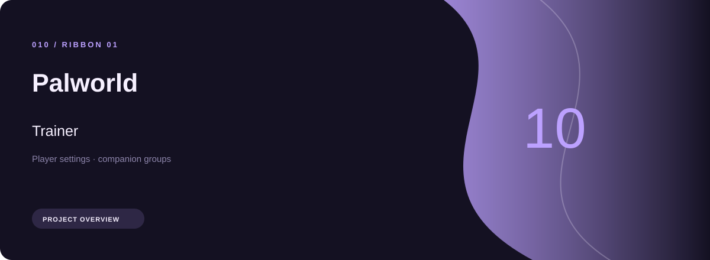
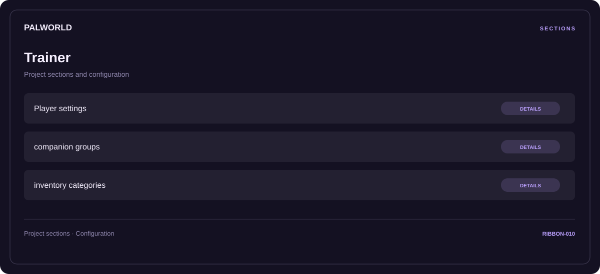

# ⚡ Palworld Trainer

**Player settings · Companion groups · Inventory categories**

## ⚡ Features

A task-oriented Palworld trainer workspace: player settings first, companion groups next, and inventory categories as the final reference area.

### ⚙️ Player settings

Character-related parameters and the settings associated with the selected category.

### 🧩 Companion groups

A dedicated section for companion groups and the configuration details associated with that area.

### ⌨️ Inventory categories

Inventory and resource categories organized alongside their related values and notes.

## 🖥️ Project navigation

## 📥 Download

The button and cover open the project's download page. Use the information supplied with the downloaded package for installation and release-specific requirements.

## 📚 Project documentation

- [Feature reference](docs/FEATURES.md)
- [Download information](docs/DOWNLOAD.md)
- [Project page](index.html)

---

Palworld Trainer · Program documentation and download information.
